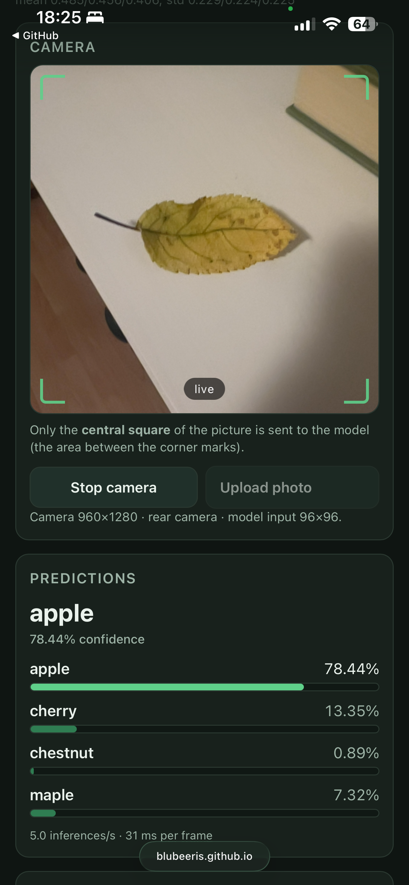
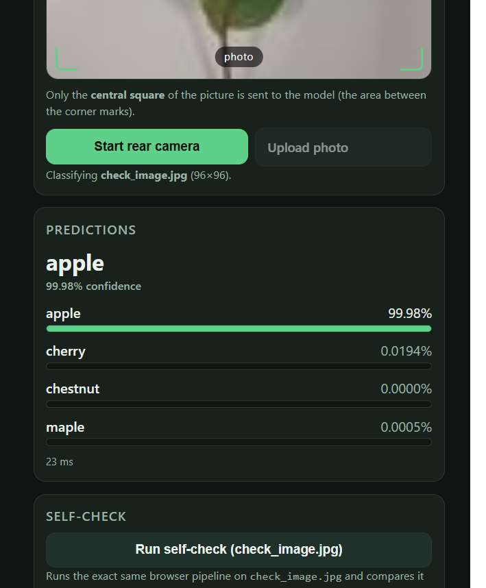

appka funguje na mobile (apple - safari), treba povolit kameru,  5.0 inferences/s · 31 ms per frame
 
 

check_expected.json:
{
 "apple": 0.9998010993003845,
 "cherry": 0.00019359921861905605,
 "chestnut": 7.461519402340855e-08,
 "maple": 5.2317768677312415e-06
}

screenshot.png (v repozitari):
{
 "apple": 0.9998,
 "cherry": 0.000194,
 "chestnut": 0.000000,
 "maple": 0.000005
}

zhoduju sa

vyrez stred. stvorca (riadky 198–204).
 =========================================================================
   Preprocessing — central square -> resize -> 0..1 -> per-channel (x-mean)/std
   Output: Float32Array in CHW order, shaped [1, 3, size, size]
   ========================================================================= */
function tensorFrom(source, srcW, srcH) {
  const size = INFO.input_size;
  if (work.width !== size || work.height !== size) { work.width = size; work.height = size; }

  const side = Math.min(srcW, srcH);              // central square of the frame
  const sx = (srcW - side) / 2, sy = (srcH - side) / 2;

  workCtx.imageSmoothingEnabled = true;
  if ("imageSmoothingQuality" in workCtx) workCtx.imageSmoothingQuality = "high";
  workCtx.clearRect(0, 0, size, size);
  workCtx.drawImage(source, sx, sy, side, side, 0, 0, size, size);

Delenie 255 (riadky 212–214). 
for (let i = 0; i < plane; i++) {
    const o = i * 4;
    out[i]              = (px[o]     / 255 - mean[0]) / std[0];
    out[plane + i]      = (px[o + 1] / 255 - mean[1]) / std[1];
    out[2 * plane + i]  = (px[o + 2] / 255 - mean[2]) / std[2];
    // alpha is ignored; JPEG/video frames are opaque
  }
  return new window.ort.Tensor("float32", out, [1, 3, size, size]);

mean/std nie su v kode, citaju sa z model_info.json (:209, :753) = sa nemozu rozist s exportom, a ToTensor v zapisniku je presne to iste /255 plus prehadzoanie (H,W,C) na (C,H,W)

Poradie kanalov (riadky 208–217).
const out = new Float32Array(3 * plane);
  const mean = INFO.mean, std = INFO.std;
  for (let i = 0; i < plane; i++) {
    const o = i * 4;
    out[i]              = (px[o]     / 255 - mean[0]) / std[0];
    out[plane + i]      = (px[o + 1] / 255 - mean[1]) / std[1];
    out[2 * plane + i]  = (px[o + 2] / 255 - mean[2]) / std[2];
    // alpha is ignored; JPEG/video frames are opaque
  }
  return new window.ort.Tensor("float32", out, [1, 3, size, size]);
}

Does it match model_info.json and the transform of the notebook? - ano, zhoduje sa
ctrl+f pre POST a XMLHttpRequest = 0 vysledkov - nic by sa nemalo odosielat

od agenta: fetch volá trikrát, model_info.json (:753), check_expected.json (:391), leaf_model.onnx (:761) – všetko GET z rovnakého zdroja;
cdn.jsdelivr.net a unpkg.com (:156-159) – jediné, čo telefón posiela von, je žiadosť o knižnicu onnxruntime-web 1.20.1, nie o fotografie;
kam pixely idú: getImageData (:206) → ort.Tensor (:217) → session.run (:223), teda do lokálneho WASM, a v súbore nie je žiadny kód, by obrázok odosielal;
